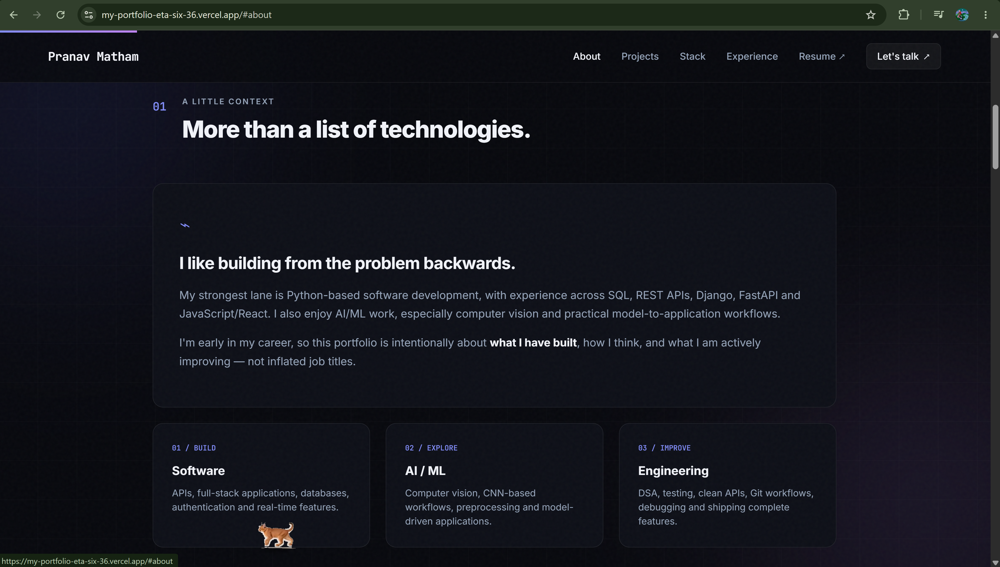
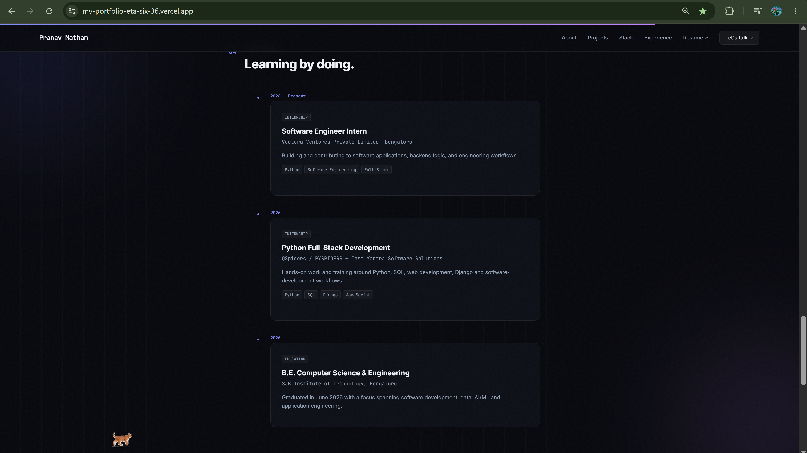
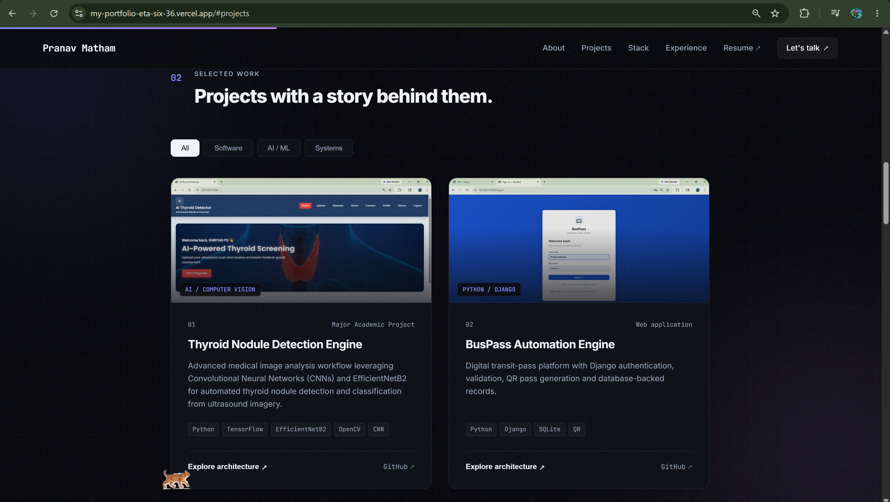
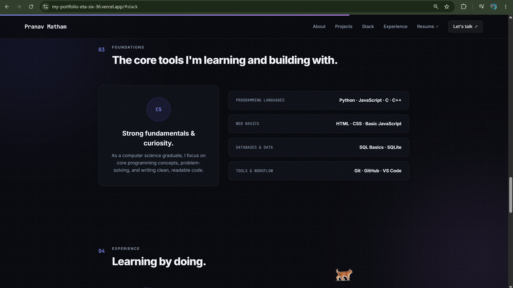
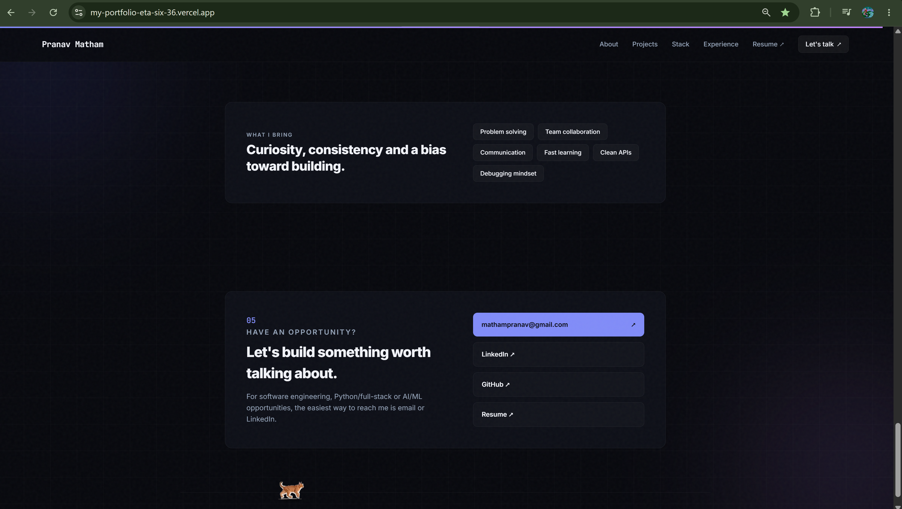

# 💻 Pranav Matham — Portfolio

A high-performance personal portfolio website showcasing software engineering projects, Python full-stack applications, and AI/ML computer vision systems. Built with a clean dark-mode developer aesthetic, terminal simulations, and interactive components.

🌐 **Live URL:** [my-portfolio-eta-six-36.vercel.app](https://my-portfolio-eta-six-36.vercel.app)

---

## 📁 Project Structure

```text
My-Portfolio/
├── index.html
├── style.css
├── script.js
├── assets/
│   └── Cat animation frames
├── about_P.png
├── experience_P.png
├── project_P.png
├── stack_P.png
├── contact_P.png
├── thyroid.png
├── buspass.png
├── NeuroSphere-X.png
├── railway.png
├── Nutri-AI.png
├── home.png
└── Pranav_Matham_Resume.pdf
```

---

## 🗄️ Core Components & Architecture

### `index.html` — Markup & Layout

| Section        | Description                                                             |
| :------------- | :---------------------------------------------------------------------- |
| **Header**     | Sticky navigation with responsive menu and quick links                  |
| **Hero**       | Introductory content, CTAs, interactive terminal widget, and statistics |
| **Marquee**    | Infinite scrolling technology ticker                                    |
| **About**      | Developer context, engineering mindset, and core principles             |
| **Projects**   | Filterable project grid with Software, AI/ML, and Systems categories    |
| **Stack**      | Languages, frameworks, tools, and technical foundations                 |
| **Experience** | Professional internship and educational timeline                        |
| **Contact**    | Direct contact options, email, and footer information                   |

### `script.js` — Interactivity & Logic

| Functionality          | Implementation                                                           |
| :--------------------- | :----------------------------------------------------------------------- |
| **Project Filtering**  | Category-based DOM filtering for All / Software / AI / Systems           |
| **Dynamic Modals**     | Project architecture and technical details displayed through modal cards |
| **Terminal Widget**    | Interactive command-line simulation with clipboard/email functionality   |
| **Walking Cat Sprite** | Event-driven character animation and interaction                         |
| **Scroll Progress**    | Dynamic reading-progress indicator based on viewport position            |

---

## 🎨 `style.css` — Design System

The stylesheet contains the visual design system and responsive behavior of the portfolio.

* Custom CSS variables
* Dark developer-focused theme
* Responsive layouts
* Flexbox and CSS Grid
* Typography and font styling
* Custom animations and transitions
* Blur/orb visual effects
* Responsive navigation
* Project cards and modal styling
* Terminal widget styling
* Mobile and desktop adaptations

---

## 📦 `assets/` — Static Assets

Contains the supporting assets used by the portfolio.

* Cat animation frames
* Character sprites
* Supporting visual resources

---

## 🖼️ Portfolio Screenshots

The repository contains screenshots showcasing the major sections of the portfolio.

| File               | Section            |
| :----------------- | :----------------- |
| `about_P.png`      | About section      |
| `experience_P.png` | Experience section |
| `project_P.png`    | Projects section   |
| `stack_P.png`      | Technology stack   |
| `contact_P.png`    | Contact section    |

---

## 🚀 Project Previews

| File                | Project                           |
| :------------------ | :-------------------------------- |
| `thyroid.png`       | Thyroid Nodule Detection Engine   |
| `buspass.png`       | BusPass Automation Engine         |
| `NeuroSphere-X.png` | NeuroSphere-X Smart City Platform |
| `railway.png`       | Railway Reservation System        |
| `Nutri-AI.png`      | FoodieAI Nutrition Vision         |
| `home.png`          | Smart Autonomous Home Node        |

---

## ⚙️ Setup & Local Development

### 1. Prerequisites

* A modern web browser such as Chrome, Firefox, Edge, or Safari
* VS Code
* Live Server extension *(optional)*

### 2. Clone the Repository

```bash
git clone https://github.com/PRANAV-MS25/My-Portfolio.git
cd My-Portfolio
```

### 3. Run Locally

This is a static web application built using vanilla web technologies.

You can either:

* Open `index.html` directly in your browser, or
* Open the project in VS Code and select **Go Live** using the Live Server extension.

---

## 🚀 Tech Stack

| Category            | Technologies / Tools                           |
| :------------------ | :--------------------------------------------- |
| **Frontend**        | HTML5, CSS3, JavaScript (ES6+)                 |
| **Layout**          | Flexbox, CSS Grid                              |
| **Styling**         | CSS Variables, Custom Animations, Blur Effects |
| **Typography**      | Inter, JetBrains Mono                          |
| **Version Control** | Git, GitHub                                    |
| **Deployment**      | Vercel                                         |
| **Architecture**    | Static Client-Side Web Application             |

---

## 🔄 User Interaction Flow

```text
User visits the portfolio
        ↓
Hero Section
        ↓
Interactive Terminal + Developer Stats
        ↓
About Section
        ↓
Technology Marquee
        ↓
Projects Section
        ↓
Filter Projects
        ↓
Open Project Architecture Modal
        ↓
Experience & Education
        ↓
Contact Section
        ↓
Email / Resume / Social Links
```

---

## 🌐 URL Reference / Anchors

| Anchor / Link              | Target                 |
| :------------------------- | :--------------------- |
| `#top`                     | Top / Hero Section     |
| `#about`                   | About Section          |
| `#projects`                | Projects Grid          |
| `#stack`                   | Technology Stack       |
| `#experience`              | Experience & Education |
| `#contact`                 | Contact Section        |
| `Pranav_Matham_Resume.pdf` | Downloadable Resume    |

---

## ✅ Features Implemented

* Fully responsive mobile and desktop layout
* Semantic HTML5 structure
* Custom CSS variable-based design system
* Dark developer-focused UI
* Interactive project detail modal cards
* Project category filtering
* Interactive terminal widget
* Clipboard email functionality
* Walking cat animation and easter egg
* Dynamic scroll-progress indicator
* Responsive navigation
* Integrated PDF resume
* Project showcase with technical architecture details
* Vercel deployment

---

## 📸 Portfolio Preview

### 1. Overview & Sections

| About | Experience & Education |
| :---: | :---: |
|  |  |

### 2. Work & Foundations

| Selected Projects | Core Tech Stack |
| :---: | :---: |
|  |  |

### 3. Connection

| Contact |
| :---: |
|  |

---

## 🌐 Live Portfolio

**Portfolio:** [my-portfolio-eta-six-36.vercel.app](https://my-portfolio-eta-six-36.vercel.app)

**GitHub Repository:** [github.com/PRANAV-MS25/My-Portfolio](https://github.com/PRANAV-MS25/My-Portfolio)

---

© 2026 **Pranav Matham**. All rights reserved.
